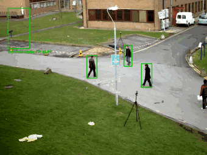
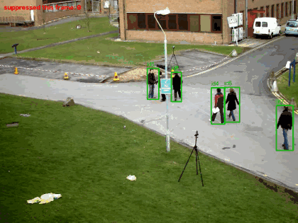

# YOLO static-detection filter



*Demo on OpenCV's `vtest.avi`: green = kept movers; the red box (top-left) is an injected static
false positive the gate suppresses after warmup, kept suppressed even as people walk through it.*

Suppresses **permanently-static false-positive boxes** in Ultralytics YOLO video —
e.g. a bolted steel frame or a block repeatedly flagged as a "worker" on a construction
site — while keeping real people who move then pause.

## Real-footage check (OpenCV `vtest.avi`, yolo11n + CLIP stage)



*Cyan = a still person the gate examined and kept because CLIP saw a person; orange = kept by the
confidence/liveness fallback; green = moving people. Raw, un-injected footage.*

- 795 frames, 4,256 person detections, 48 tracks. People who stood still long enough to become
  static suspects were all **kept**; **0 real people removed**.
- **Honest scope:** this clip contains no real static false positives, so it shows the gate does not
  over-remove; it does not show it catching a real one (that needs raw worksite footage).
- **Bug found by this check, and fixed:** an earlier version let a CLIP "structure" verdict remove a
  detection on its own. On this clip CLIP misread a still person half-hidden behind a pole and sign
  as "structure" and the gate dropped them for 7 frames. Now CLIP can *keep* a detection but never
  *remove* one alone — removal always also requires the detection to be pixel-frozen (a living
  person is not). Locked in by a regression test that fails on the old rule and passes on the new one.

## The idea (why it works, and its limits)
A worker standing still has no motion *right now* — so you can't filter on current motion
alone or you'd delete real people. The real signal is **"this detection has never
moved."** A fixed structure is static forever; a worker walked into frame at some point.

- **Per-track centroid memory** (with `model.track`): once a track's box CENTRE has moved
  more than `max(move_eps_px, move_eps_frac * box_diagonal)` from where it first appeared,
  it is kept for the rest of the clip even if it later goes still. A track whose box stays
  pinned past `static_patience` frames is suppressed. Keying on the detection's *own*
  centre (not foreground inside its box) makes it **immune to people walking through** a
  static structure's box — a real failure mode found and fixed during testing on vtest.avi.
- **Spatial fallback** (no tracking): a box over a region with no foreground motion for
  more than `static_patience` frames is suppressed (MOG2 background subtractor).
- **Positive false-positive evidence required (keeps valid static objects):** a pinned detection
  is dropped only with evidence it's actually a false positive — it must be **low-confidence AND
  pixel-frozen** (temporal per-pixel variance near the noise floor). A confidently-detected or
  micro-moving (living) object is kept, so a worker who pauses is not removed.
- **Optional CLIP appearance verifier (`clip_verifier.py`, pattern-based & motion-independent):**
  the authoritative check for static detections. It keeps anything CLIP sees as a **person**
  (including a worker stationary *since the camera turned on* — identity by appearance, no motion
  history needed) and drops anything CLIP sees as a **structure** (even if YOLO was confident).
  Runs only on suspicious pinned detections, cached per track. Enable with `--clip`.
- **Whole-picture vibration is acknowledged**: a phase-correlation detector measures the
  global frame-to-frame shift; when the camera shakes (high-confidence global shift, or a
  huge share of the frame changing), `filter.vibrating` goes True, suppression is paused and
  state updates are frozen so jitter can't be mistaken for motion or corrupt the gate. The
  runners overlay "CAMERA VIBRATION - gating paused" while it is active.

**Honest limits:** it does not recover *missed* detections (a recall problem). It will
suppress an object that is static for the entire clip and never once tracked as moving.
Use `model.track` (not bare `predict`) so the motion memory works per object.

## Validated
`python static_detection_filter.py` runs a deterministic planted-case self-test: a static
fake box next to a moving blob. Result: static box suppressed (kept 0.00), moving object
kept (1.00). The filter logic is proven before any real footage.

## Run on video
```bash
python run_on_video.py --source site.mp4 --model yolo11n.pt --classes 0 --save out.mp4
```
- `--classes 0` keeps only people (the worker case); omit for all classes.
- Kept boxes draw green; suppressed draw thin red (`--hide-suppressed` to omit).
- Tuning: `--static-patience` (frames before a motionless region's never-moved boxes are
  dropped; ~2 s at 30 fps by default), `--motion-thresh`, `--warmup`.

## Files
- `static_detection_filter.py` — the `StaticDetectionFilter` class + `selftest()`. No YOLO
  dependency, so it is unit-testable on its own.
- `run_on_video.py` — Ultralytics `model.track` + the filter, draws/saves results.

## Upstream note
This fits the shape of an Ultralytics **solution** (like object-counting / heatmaps). If it
proves out on real footage, it could be offered upstream — check Ultralytics' contribution
+ AI policy first and hand the PR to a human author per the repo's rules.
